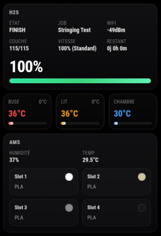
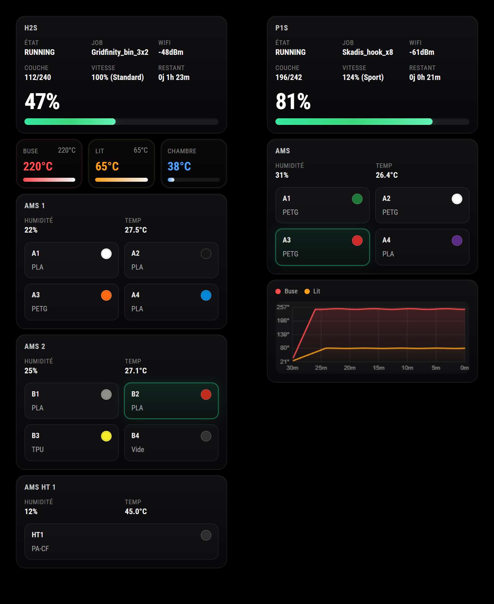

# Bambulink Module for MagicMirror [](https://raw.githubusercontent.com/TAGinside/MMM-Bambulink/main/LICENSE)
Module: MMM-Bambulink

This [MagicMirror²](https://github.com/MagicMirrorOrg/MagicMirror) module displays the live status of your Bambu Lab 3D printer (print progress, temperatures, AMS filaments) directly on your mirror.

MMM-Bambulink connects to your printer over the local network using Bambu Lab's LAN credentials (MQTT over TLS). Data is pushed by the printer in real time, no cloud request is made by the module.

> **Important: "LAN Only" mode must stay DISABLED on the printer.** The module only needs the printer IP address, LAN Access Code and serial number; the printer can stay connected to Bambu Cloud.



## Requirements

To use this module, you need the following information:

- The IP address of your Bambu Lab printer
- The printer's LAN Access Code
- The printer serial number

You can find them on the printer screen (network / LAN settings and device information) or in Bambu Studio / Bambu Handy. These three values are required in the configuration to establish the connection with your printer.

## Key Features

- Monitor your Bambu Lab printer directly from MagicMirror².
- Secure local connection using **MQTT/TLS** on port **8883**.
- Real-time updates pushed by the printer, plus a periodic full status request (`pushallInterval`).
- Support for **incremental reports** (P1 / A1 series and others): partial MQTT messages are merged into the last known state, so the AMS, layer, job name and temperatures stay displayed between two full reports.
- "Printer offline" message with the time of the last data received when the printer is switched off.
- Custom printer title using the `printerModel` option.
- Two temperature display modes:
  - **tile view** (`tiles`)
  - **graph view** (`graph`)
- Visual **AMS** display, for **every connected AMS** (AMS 1 to 4 and AMS HT):
  - humidity and temperature of each AMS,
  - filament color and loaded filament type for each slot,
  - slots named like in Bambu Studio (A1–A4, B1–B4…, HT1).
- Automatic highlight of the **active AMS slot** during printing, on any AMS, including when the printer switches filament.
- **Several printers**: add one MMM-Bambulink entry per printer in `config.js`.
- Simple installation inside the standard MagicMirror² module structure.

## Development Status

The module is functional and ready to use in a standard MagicMirror² environment.

The project is still evolving, especially in terms of UI improvements, advanced display options, and visual customization.

You can support my work here -> <a href="https://buymeacoffee.com/taginside"></a>

## Compatibility

MMM-Bambulink is designed for **MagicMirror²** and **Bambu Lab printers** with **"LAN Only" mode disabled** (default printer setting).

It has been tested on a Bambu Lab **H2S**. Feedback for other models (X1, P1, P2S, A1, H2D…) is welcome.

## Installation

Go to your MagicMirror `modules` directory:

```bash
cd ~/MagicMirror/modules
```

Clone the repository:

```bash
git clone https://github.com/TAGinside/MMM-Bambulink
```

Enter the module directory:

```bash
cd MMM-Bambulink
```

Install the Node.js dependencies:

```bash
npm install --omit=dev
```

## Configuration

Add the module to the `modules` array in your `config/config.js` file:

```javascript
  {
    module: "MMM-Bambulink",
    position: "top_left",
    config: {
      ip: "192.168.1.x",                // Printer IP address
      accessCode: "xxxxxxxx",           // LAN Access Code
      serial: "XXXXXXXX",               // Printer serial number
      updateInterval: 5000,             // Connection status check in ms
      offlineTimeout: 60000,            // No data for this long (ms) => "printer offline"
      pushallInterval: 300000,          // Full status request every 5 min (min 60000, 0 = off)

      printerModel: "H2S",              // Displayed printer name or model
      temperatureDisplayMode: "tiles",  // "tiles" or "graph"

      display: {
        scale: 1,
        width: 320,
        graphMinutes: 30
      },

      temperatureColors: {
        nozzle: "#ff4d4f",              // Red
        bed: "#ff9f1a",                 // Orange
        chamber: "#4da3ff"              // Blue
      }
    }
  },
```

Then check your configuration and restart MagicMirror²:

```bash
cd ~/MagicMirror
node --run config:check
```

(On older MagicMirror² installs: `npm run config:check`.)

### Several printers

Add one entry per printer, each with its own `ip`, `accessCode` and `serial`:

```javascript
  {
    module: "MMM-Bambulink",
    position: "top_left",
    config: { ip: "192.168.1.10", accessCode: "xxxxxxxx", serial: "XXXXXXXX", printerModel: "H2S" }
  },
  {
    module: "MMM-Bambulink",
    position: "top_right",
    config: { ip: "192.168.1.11", accessCode: "yyyyyyyy", serial: "YYYYYYYY", printerModel: "P1S", temperatureDisplayMode: "graph" }
  },
```

Result with this configuration: on the left an H2S with three AMS (AMS 1, AMS 2 and an AMS HT, active slot B2 highlighted), on the right a P1S with one AMS and the temperature graph (demo data):



### Options

| Option | Description | Type | Default |
|---|---|---|---|
| `ip` | **Required.** Printer IP address on your local network. | string | `""` |
| `accessCode` | **Required.** Printer LAN Access Code. | string | `""` |
| `serial` | **Required.** Printer serial number. | string | `""` |
| `printerModel` | Title displayed at the top of the module. | string | `"Bambu Lab"` |
| `mqttPort` | Printer MQTT port. | number | `8883` |
| `useTLS` | Use MQTT over TLS (required by Bambu printers). | boolean | `true` |
| `updateInterval` | How often (ms) the display checks the connection status. Printer data itself is pushed in real time. `0` disables the check. | number | `5000` |
| `offlineTimeout` | If no data is received for this long (ms), the printer is shown as offline and the module reconnects. | number | `60000` |
| `pushallInterval` | How often (ms) a full status is requested from the printer ("pushall"). Values below `60000` are raised to `60000` to avoid slowing the printer down. `0` disables it (a full status is still requested at each connection). | number | `300000` |
| `temperatureDisplayMode` | `"tiles"` (nozzle / bed / chamber tiles) or `"graph"` (temperature graph). | string | `"tiles"` |
| `display.scale` | Global zoom of the module. | number | `1` |
| `display.width` | Module width in pixels. | number | `320` |
| `display.graphHeight` | Graph height in pixels. | number | `120` |
| `display.graphMinutes` | Time span of the graph in minutes. | number | `30` |
| `display.graphLineWidth` | Graph line width in pixels. | number | `2` |
| `display.graphShowFill` | Fill the area under the graph lines. | boolean | `true` |
| `display.graphShowLegend` | Show the graph legend. | boolean | `true` |
| `display.graphShowGrid` | Show the graph grid. | boolean | `true` |
| `display.graphShowDots` | Show a dot on every measured point of the graph lines. | boolean | `false` |
| `display.borderRadius` | Panel corner radius in pixels. | number | `14` |
| `display.contentGap` | Space between elements inside the module (px). | number | `8` |
| `display.sectionGap` | Space between panels (px). | number | `8` |
| `display.fontSizes.base` | Base font size (px). | number | `12` |
| `display.fontSizes.temperatureValue` | Temperature value font size (px). | number | `18` |
| `display.fontSizes.temperatureTarget` | Target temperature font size (px). | number | `11` |
| `display.fontSizes.graphLabel` | Graph axis labels font size (px). | number | `10` |
| `temperatureColors.nozzle` | Nozzle color (tiles and graph). | string | `"#ff4d4f"` |
| `temperatureColors.bed` | Bed color (tiles and graph). | string | `"#ff9f1a"` |
| `temperatureColors.chamber` | Chamber color (tiles and graph). | string | `"#4da3ff"` |

You only need to set the `display` and `temperatureColors` sub-options you want to change: missing ones use the default values above.

## How to Use

After adding the module to `config/config.js`, restart MagicMirror².

Once running, the module will display your Bambu Lab printer information in the selected MagicMirror position, such as `top_left`, using the temperature display mode you configured.

When the module is hidden (for example by a presence sensor or page module), it stops requesting full status updates from the printer and resumes when it is shown again.

## Update

To update the module:

```bash
cd ~/MagicMirror/modules/MMM-Bambulink
git pull
npm install --omit=dev
```

Then restart MagicMirror². Tada !

## Troubleshooting

- **"Bambu Lab : connexion en cours…" forever / "Bambu Lab : imprimante hors ligne"**: check the IP address, Access Code and serial number, make sure the printer is on the same network as the Raspberry Pi, and that "LAN Only" mode is disabled.
- Logs are printed by the module helper with the prefix `MMM-Bambulink [serial]:` in the MagicMirror² terminal, or with `pm2 logs` if you run MagicMirror² with pm2.

## Use Cases

MMM-Bambulink is especially useful in:

- a workshop,
- a technical office,
- a home lab,
- a smart home dashboard centered around MagicMirror².

It allows you to quickly monitor an active print, confirm that the printer is responding, and keep a live visual overview of the current job without constantly opening Bambu Studio.

## About

The module is open source (MIT license) and free to use and modify.

Feedback is always welcome, especially for printer compatibility, AMS behavior, and display improvements.
